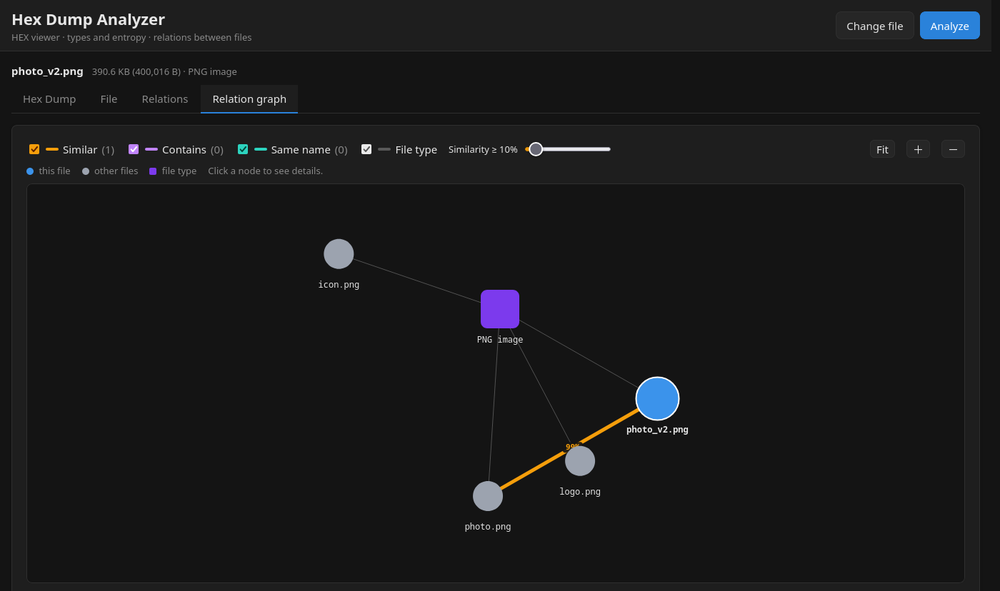
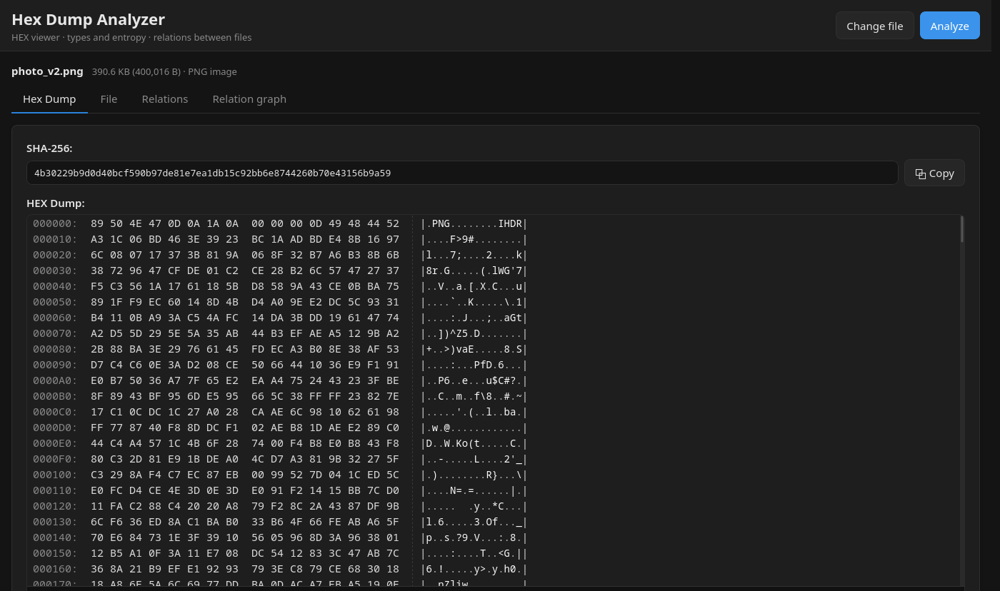
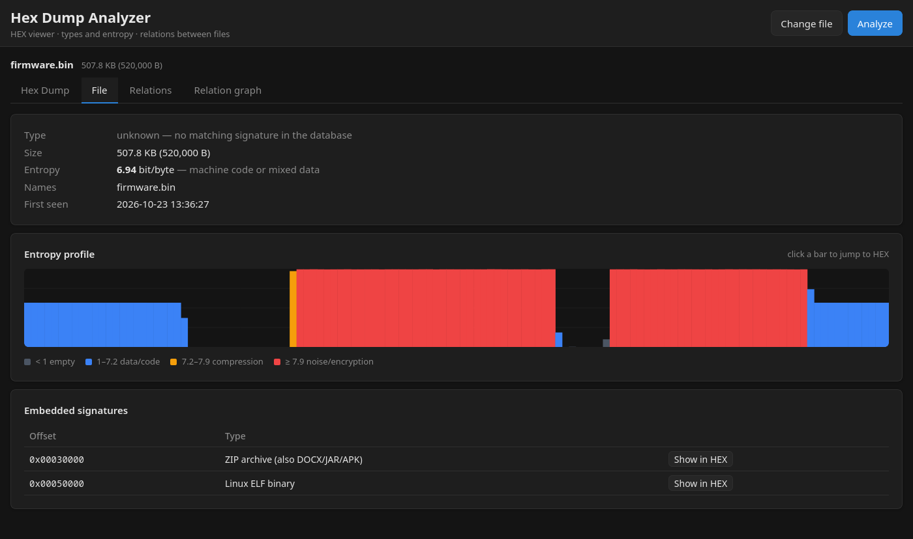
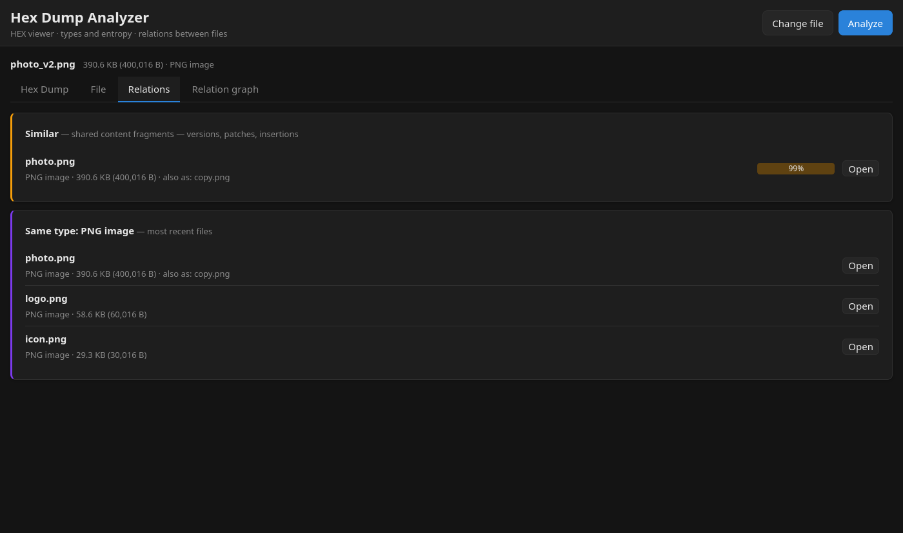

# 🔍 Hex Analyzer

> A professional binary file analyzer with a virtualized hex dump, automatic signature detection and an interactive relation graph.

[](https://fastapi.tiangolo.com/)
[](https://reactjs.org/)
[](https://www.docker.com/)
[](LICENSE)



---

## ✨ Features

### 🎯 Key capabilities
- **📁 File upload** - Upload binary files up to 100 MB
- **🔍 Virtualized Hex Dump** - Smooth browsing of even GB-sized files without lag
- **🎨 Interactive graph** - Relations between files: similar (shared content-defined chunks, robust to insertions), contains (embedded signatures), same name, same type (react-force-graph-2d + d3-force)
- **⚡ Paged download** - Parallel download of large files (6 workers)
- **🔐 Automatic detection** - File type recognition based on magic bytes (also at an offset, e.g. TAR @257, ISO @32769)
- **📈 Entropy** - Shannon entropy of the whole file + entropy profile with a chart (click → jump in HEX)
- **🧩 Embedded files** - Searching for signatures inside a file (e.g. PNG in firmware, ZIP in EXE)
- **📊 Signature and file database** - SQLite: ~34 built-in types, each unique file (SHA-256) stored once, with the list of names it was uploaded under
- **🌙 Dark theme** - Lightweight UI on custom CSS (no component libraries)

### 🛠️ Technical details
- **Backend**: FastAPI + Python 3.12 + numpy (versions locked with hashes in `requirements.txt`, generated from `requirements.in`)
- **Frontend**: React 18 + Vite + react-window + react-force-graph-2d, custom CSS
- **Database**: SQLite (plain SQLAlchemy 2.0)
- **Data**: everything in a single `DATA_DIR` directory (uploads, jobs, archive, database)
- **Archiving**: A `.gz` copy of every file (can be disabled with `ARCHIVE=0`)
- **API**: RESTful, paged byte download, relation graph, type database (`/types`)
- **Deployment**: Docker + docker-compose (hardened non-root containers, digest-pinned images), Caddy (HTTPS + password)
- **Quality**: pytest + ruff (backend), Vitest + ESLint + Prettier (frontend), CI on GitHub Actions

---

## 🚀 Quick Start

### Option 1: Docker (Recommended) 🐳

```bash
# Clone the repository
git clone https://github.com/your-username/hex-analyzer.git
cd hex-analyzer

# Addresses the app should answer on (the HTTPS certificate will be issued for them)
cp .env.example .env        # and fix the IP address (HEX_HOSTS, HEX_DEFAULT_SNI, HEX_BIND)

# App login and password (default login "admin"; a different one: ./caddy/set-password.sh john)
./caddy/set-password.sh
# … creates caddy/password.txt (password) and caddy/auth.caddy (hash) — both outside git
# (required: docker compose refuses to start without caddy/auth.caddy)

docker compose up -d

# App: https://localhost  (login + password)
# From the LAN (https://192.168.1.50) only with HEX_BIND set to the LAN IP or 0.0.0.0 in .env
# API: https://localhost/api/...
```

**HTTPS and login** are provided by Caddy (`caddy/Caddyfile`): its own CA (`tls internal`), a password
(`basic_auth`, bcrypt cost 10), redirect from HTTP, security headers (CSP, a 1-day HSTS, Permissions-Policy, COOP/CORP — also on error responses).
Details (password files, changing the login, access by IP): [caddy/README.md](caddy/README.md). It only answers on the addresses
in `HEX_HOSTS` — other host names get an empty response (protection against DNS rebinding); the backend checks
the `Host` header as well (`ALLOWED_HOSTS`). By default Caddy listens only on `127.0.0.1` (`HEX_BIND` in `.env`) —
Docker publishes ports past the host firewall, so `0.0.0.0` means every network the computer joins.
To keep the browser from warning you, import the Caddy CA as a trusted authority:
`docker compose cp caddy:/data/caddy/pki/authorities/local/root.crt ./caddy-hex-root.crt`
(Firefox: Settings → Privacy & Security → Certificates → Authorities → Import).
Do not delete the `caddy_data` volume — a new CA would have to be imported again on every device.

The backend and frontend do not publish their own ports — the only way in from outside is through Caddy (443, with 80 redirecting to HTTPS), which forwards traffic to nginx in the frontend (`frontend:8080`); nginx forwards `/api` to the backend. The frontend starts only once the backend healthcheck (`/ping`, defined in `backend/Dockerfile`) reports ready. All data goes to a single `hex_data` volume (`/app/data`).

Containers do not run as root: the backend runs as user `app` (uid 10001), the frontend uses the `nginxinc/nginx-unprivileged` image (port 8080). All three have a read-only root filesystem, drop every Linux capability (Caddy gets back only `NET_BIND_SERVICE`), run with `no-new-privileges` and have memory/process limits. Base images and the Caddy image are pinned by digest. Caddy gets only `Caddyfile` and `auth.caddy` — `password.txt` is not mounted.

> **Upgrading an older installation:** a `hex_data` volume created while the backend ran as root must be handed over to the new user once:
> ```bash
> docker compose run --rm --no-deps --user root --entrypoint chown backend -R 10001:10001 /app/data
> ```

**That's it!** The app is ready to use. 🎉

---

### Option 2: Manual installation

#### Requirements
- Python 3.12+
- Node.js 22 (the version used by the Docker image and CI)
- npm

#### Backend

```bash
cd backend

# Create a virtual environment
python -m venv venv
source venv/bin/activate  # Windows: venv\Scripts\activate

# Install dependencies (requirements-dev.txt = the same + pytest and ruff)
# Lock files with hashes, generated for Python 3.12
pip install -r requirements.txt

# Start the server
uvicorn main:app --reload --port 8000
```

Backend available at: `http://localhost:8000` (interactive API docs at `/docs` only with `ENABLE_DOCS=1`). Data (uploads, jobs, archive, `hex.db`) goes to `backend/data/` (the `DATA_DIR` variable).

#### Frontend

```bash
cd frontend

# Install dependencies
npm install

# Start the development server (Vite)
npm run dev
```

Frontend available at: `http://localhost:5173`

**Note**: By default the frontend calls the API at `/api` (a different address: `VITE_API_URL`, see Configuration). In Docker nginx forwards it, and with `npm run dev` the Vite server (`vite.config.js`) forwards `/api` to `http://localhost:8000`, stripping the `/api` prefix. The frontend and API thus share one address and CORS is not needed (it is disabled by default in the backend).

Other scripts: `npm run build` (production build into `dist/`), `npm run preview` (preview the build), `npm run lint`, `npm run format`, `npm test`.

---

## 📖 Usage

### 1. Uploading a file

1. Click **"Choose file"** in the top menu
2. Select a binary file (max 100 MB)
3. Click **"Analyze"**

The app automatically:
- Uploads the file to the server
- In a single pass over the file computes: SHA-256, entropy (whole file + profile), hashes of content-defined chunks (~1.2 KB) and finds signatures embedded inside (with header verification)
- Recognizes the file type (magic bytes from the database — the longest matching signature wins)
- Stores the file in the database (same SHA-256 = same entry, only another name is added)
- Downloads the file bytes in pages and displays the hex dump

### 2. Browsing the Hex Dump

**Tab: Hex Dump**

- 📜 **Scroll** - Smooth scrolling of even GB-sized files
- 🖱️ **Click** - Select a single byte
- ⇧ **Shift + click** - Select a byte range
- 🖱️ **Right click** - Context menu:
  - Copy byte (HEX)
  - Copy offset
  - Copy range (HEX)

**Display format:**
```
000000: 4D 5A 90 00 03 00 00 00  04 00 00 00 FF FF 00 00  |MZ..............|
000010: B8 00 00 00 00 00 00 00  40 00 00 00 00 00 00 00  |........@.......|
```

### 3. File information

**Tab: File**

- 📝 **Type** - name, extension, magic and signature offset (or "unknown")
- 📏 **Size**
- 📈 **Entropy** - in bits per byte, with a plain-language description (e.g. "compressed data", "noise — compression or encryption")
- 🏷️ **Names** - all names the same file was uploaded under (the first 20, then "+N more")
- 📊 **Entropy profile** - bar chart (SVG); clicking a bar jumps to that spot in the Hex Dump
- 🧩 **Signatures inside the file** - offset + type table, **"Show in HEX"** button

### 4. Relations

**Tab: Relations**

A list grouped by relation:
- 🟦 **Identical** - the same SHA-256 uploaded under different names
- 🟧 **Similar** - shared content-defined chunks of ~1.2 KB (Jaccard), with a percentage bar
- 🟪 **Contains** - signatures of other types inside the file (e.g. "2× from 0x1A00")
- 🟩 **Same name** - same name, different content (e.g. successive firmware versions)
- 🟣 **Same type** - the newest files of the same type

The **"Open"** button switches the app to the selected file (you stay on the same tab).

### 5. Relation graph

**Tab: Relation graph**

Interactive graph (react-force-graph-2d):
- 🔵 **Blue circle with an outline** - This file
- ⚪ **Grey circles** - Other files
- 🟪 **Purple squares** - File types (files of the same type cluster around them)
- Identical files are a single node with a list of names

**Controls:**
- ☑️ **Relation checkboxes** (Similar / Contains / Same name / File type) - toggle a relation on/off and double as the color legend
- 🎚️ **Similarity ≥ X%** - similarity threshold slider
- 🔍 **Fit** - Fit the view
- ➕ / ➖ - Zoom in / Zoom out

**Interactions:**
- 🖱️ **Node click** - Side panel with details (names, type, size, entropy, SHA-256, or the type's magic/offset)
- 📂 **"Open this file"** - Switches to the selected file
- 🖱️ **Hover** - Dims nodes not connected to the hovered one
- 🖐️ **Drag & drop** - Move a node
- ⌨️ **Esc** / click on the background - Close the side panel

The graph is computed live by the backend and cached per file in the browser; entering Relations or Relation graph fetches it again when the cached copy is older than 10 s, so files uploaded later show up too.

File and type names coming from the server are displayed with hidden control and bidi characters made visible as `⟨U+XXXX⟩` (so `evil<U+202E>fdp.exe` cannot pose as `evilexe.pdf`). A rendering error in one tab shows a message in that tab instead of blanking the app.

---

## 🏗️ Architecture

```
hex-analyzer/
├── backend/                    # FastAPI backend
│   ├── main.py                # Main application + API endpoints
│   ├── models.py              # SQLAlchemy models (file_types, files, file_names, file_blocks, embedded)
│   ├── requirements.in        # Python dependencies (edit this one)
│   ├── requirements.txt       # Lock with hashes (pip-compile from requirements.in)
│   ├── requirements-dev.in    # + pytest, ruff (lock: requirements-dev.txt)
│   ├── pyproject.toml         # pytest and ruff configuration
│   ├── Dockerfile             # Backend container (user app, HEALTHCHECK)
│   ├── tests/                 # pytest: test_api, test_graph, test_features, test_maintenance, test_security
│   └── modules/
│       ├── analyzer.py        # Analysis: features → type from the database → store in the database → result
│       ├── features.py        # Single pass: SHA-256, entropy, content-defined chunks, embedded signatures
│       ├── graph.py           # Relation graph around a file (computed live)
│       └── filetypes_seed.py  # Initial signature database (~34 types)
│
├── frontend/                  # React frontend (Vite)
│   ├── index.html            # Page template (loads src/main.jsx)
│   ├── src/
│   │   ├── App.jsx           # Main component
│   │   ├── main.jsx          # Entry point + import styles/index.css
│   │   ├── test/setup.js     # Vitest configuration (jest-dom, cleanup)
│   │   ├── styles/
│   │   │   └── index.css     # Custom styles (dark theme)
│   │   ├── lib/
│   │   │   ├── api.js        # API client (+ upload error messages)
│   │   │   ├── format.js     # Formatting (bytes, hex, entropy description, displayName)
│   │   │   └── format.test.js
│   │   ├── hooks/
│   │   │   ├── usePreloadAll.js   # File download
│   │   │   └── useElementSize.js  # Element size (ResizeObserver)
│   │   └── components/
│   │       ├── ErrorBoundary.jsx  # Per-tab error boundary
│   │       ├── hex/
│   │       │   ├── HexDumpVirtualized.jsx
│   │       │   └── HexDump.css
│   │       ├── file/
│   │       │   ├── FileTab.jsx    # "File" tab (type, entropy, embedded signatures)
│   │       │   └── FileTab.test.jsx
│   │       ├── links/
│   │       │   ├── LinksTab.jsx   # "Relations" tab (list)
│   │       │   └── LinksTab.test.jsx
│   │       └── graph/
│   │           ├── GraphView.jsx  # "Relation graph" tab
│   │           └── relations.js   # Relations: labels and colors (graph + list)
│   ├── vite.config.js        # Vite: /api proxy, Vitest configuration
│   ├── eslint.config.js      # ESLint (flat config)
│   ├── Dockerfile            # Frontend container (Vite build → nginx-unprivileged)
│   ├── nginx.conf            # Nginx config (port 8080, /api proxy, streamed uploads)
│   ├── public/robots.txt     # Disallow: / (keep the app out of search engines)
│   └── package.json
│
├── caddy/                    # Caddyfile, set-password.sh, README.md (HTTPS + password)
├── .github/workflows/        # CI, Security scanners, PR policy (GitHub Actions)
├── .github/scripts/          # pr_policy.py, check_licenses.py + their tests
├── .env.example              # .env template (HEX_HOSTS, HEX_DEFAULT_SNI, HEX_BIND)
├── docker-compose.yml        # Container orchestration
├── README.md                 # This file
├── CONTRIBUTING.md           # How to contribute (including the rules for using AI)
├── AGENTS.md                 # Rules for AI assistants (CLAUDE.md points to this file)
├── SECURITY.md               # Reporting vulnerabilities
└── docs/                     # Documentation
    ├── backend.md            # Backend documentation
    ├── frontend.md           # Frontend documentation
    └── signatures.md         # File signatures
```

Runtime data (the `DATA_DIR` directory, `data/` by default, `/app/data` in Docker):

```
data/
├── uploads/<job_id>_<name>           # original file
├── tmp/                              # spooled multipart uploads (TMPDIR in Docker)
├── jobs/<job_id>/meta.json           # job status (+ analysis_error on failure)
├── jobs/<job_id>/result.json         # analysis result
├── archive/<job_id>/input.bin.gz     # compressed copy (+ archive_meta.json)
└── hex.db                            # SQLite database (types, files, names, chunks, embedded signatures)
```

The old `signatures.db` database is no longer used. Tables in `hex.db`:

| Table | Contents |
|-------|----------|
| `file_types` | known signatures: name, extension, magic (HEX), offset, `scan_inside`, `builtin`; loaded from `filetypes_seed.py` on first start (with `builtin = true`); sanitised at every start |
| `files` | one row per unique content (SHA-256): size, entropy, chunk count, type, `first_seen` |
| `file_names` | every upload: name + `job_id` (the same file can have many names) |
| `file_blocks` | hashes of ~1.2 KB content-defined chunks (chunks made of a single repeated byte are skipped) — for similarity (Jaccard) |
| `embedded` | signatures found inside a file: type + offset |

On startup the backend sanitises the signature rows (normalised magic, invalid rows removed, `scan_inside` off where it makes no sense) and sweeps orphaned uploads/archives older than 1 hour (also after every analysis). Then it does housekeeping in a separate thread, so the server responds immediately: it removes orphaned entries from the database (jobs deleted e.g. during analysis) and re-analyzes old jobs (with `result.json` in the old format). A `DELETE` during an ongoing analysis is handled cleanly — the analysis finishes without an error and cleans up whatever it had already written to the database.

---

## 🔌 API Endpoints

> **CSRF protection:** every `POST`/`PUT`/`PATCH`/`DELETE` request must carry the `X-Hex-Analyzer` header (any value, e.g. `1`), otherwise the backend responds `403`. `GET` does not need it. The frontend adds it automatically.
>
> **Host check:** a `Host` header outside `ALLOWED_HOSTS` gets `400`.

### `POST /upload`
Upload a file for analysis. Responds `202 Accepted` — the analysis starts in the background. A file larger than 100 MB → `413` (an oversized `Content-Length` is rejected before the body is read). Analysis queue full (`MAX_QUEUED_JOBS`) → `503`, less than `MIN_FREE_MB` free disk space → `507`. The file name is reduced to the bare name, stripped of control/format characters and cut to 150 bytes of UTF-8 (the end with the extension is kept).

The examples below target a locally running backend (`:8000`); in Docker replace `http://localhost:8000` with `https://localhost/api` and add `-u admin:PASSWORD --cacert caddy-hex-root.crt` (login from `./caddy/set-password.sh`, password in `caddy/password.txt`).

**Request:**
```bash
curl -X POST http://localhost:8000/upload \
  -H "X-Hex-Analyzer: 1" \
  -F "file=@test.bin"
```

**Response (202):**
```json
{
  "job_id": "a3f8d9c2b1e4...",
  "status": "queued",
  "meta": {
    "job_id": "a3f8d9c2b1e4...",
    "stored_name": "a3f8d9c2b1e4..._test.bin",
    "filename": "test.bin",
    "size_bytes": 1024,
    "sha256": null,
    "analysis_ready": false,
    "status": "queued"
  }
}
```

### `GET /jobs/{job_id}`
Get the analysis status and result. `job_id` must be 32 hex characters (otherwise `422`), unknown → `404`. The status goes `queued` → `processing` → `done` or `error` (then meta contains `analysis_error`, always the generic `"Analysis failed"` — details only in the server log).

**Request:**
```bash
curl http://localhost:8000/jobs/a3f8d9c2b1e4...
```

**Response:**
```json
{
  "job_id": "a3f8d9c2b1e4...",
  "stored_name": "a3f8d9c2b1e4..._test.bin",
  "filename": "test.bin",
  "size_bytes": 1024,
  "status": "done",
  "analysis_ready": true,
  "sha256": "e3b0c44298fc1c149...",
  "result": {
    "sha256": "e3b0c44298fc1c149...",
    "file": {
      "id": 7,
      "sha256": "e3b0c44298fc1c149...",
      "size": 1024,
      "entropy": 5.8213,
      "type": { "id": 23, "name": "Linux ELF binary", "extension": "elf", "magic": "7F454C46", "offset": 0, "builtin": true },
      "first_seen": "2026-10-23T12:00:00"
    },
    "entropy_profile": [5.1, 6.3, 0.0],
    "profile_step": 4096,
    "embedded": [ { "type": { "id": 1, "name": "PNG image", ... }, "offset": 512 } ]
  }
}
```

`entropy_profile` has at most 512 points, each covering `profile_step` bytes. `embedded` skips hits with the same extension as the file itself (so that "ZIP contains ZIP" does not clutter the result). `file.type` = `null` when the type is unknown.

### `DELETE /jobs/{job_id}`
Deletes the job together with its files (upload, job directory, archive) and its name in the database; when the file has no uploads left, it disappears from the database together with its chunks and embedded signatures. Responds `204`, unknown `job_id` → `404`.

```bash
curl -X DELETE -H "X-Hex-Analyzer: 1" http://localhost:8000/jobs/a3f8d9c2b1e4...
```

### `GET /jobs/{job_id}/bytes?offset=X&length=Y`
Paged byte download. `offset` 0–2^62, `length` at most 16 MB (8 MB by default); past the end of the file the response is simply shorter or empty. When the source file is gone → `410`.

**Request:**
```bash
curl "http://localhost:8000/jobs/a3f8d9c2b1e4.../bytes?offset=0&length=1024"
```

**Response:** Binary data (application/octet-stream), without extra `x-*` headers — the file size is in `size_bytes` from meta.

### `GET /jobs/{job_id}/graph?min_similarity=0.05&limit=25`
The file's relation graph, computed live. `min_similarity` 0–1, `limit` 1–200 (per relation). While the analysis is still running → `409`.

```json
{
  "center": "f:7",
  "nodes": [
    { "id": "f:7", "kind": "file", "current": true, "label": "test.bin", "names": ["test.bin"], "names_total": 1, "job_id": "a3f8...", "sha256": "...", "size": 1024, "entropy": 5.82, "type": { ... } },
    { "id": "t:23", "kind": "type", "label": "Linux ELF binary", "extension": "elf", "magic": "7F454C46", "offset": 0 }
  ],
  "edges": [
    { "source": "f:7", "target": "t:23", "relation": "is_type" },
    { "source": "f:7", "target": "f:3", "relation": "similar", "weight": 0.98, "label": "98%" },
    { "source": "f:7", "target": "t:1", "relation": "contains", "count": 2, "label": "2× from 0x200" },
    { "source": "f:7", "target": "f:5", "relation": "same_name" }
  ]
}
```

- `is_type` - file → its type
- `similar` - shared ~1.2 KB content-defined chunks (Jaccard), `weight` 0–1
- `contains` - a signature of another type inside the file
- `same_name` - same name, different content

Identical files (same SHA-256) are a single node with a `names` list (sorted, at most 20) and `names_total`. The `job_id` of a file node points to an existing job to open (`null` when none is left).

### `GET /types`
List of signatures (file types) in the database: `id`, `name`, `extension`, `magic`, `offset`, `builtin`, `scan_inside`. `builtin: true` = a type from the initial database (cannot be deleted through the API).

### `POST /types`
Add a custom signature. Responds `201`. `409` when the same `magic` + `offset` already exists, when the number of custom types has reached `MAX_CUSTOM_TYPES` (200 by default), or — with `scan_inside` — when `MAX_CUSTOM_SCAN_TYPES` (20) custom scanned types exist.

```bash
curl -X POST http://localhost:8000/types \
  -H "X-Hex-Analyzer: 1" \
  -H "Content-Type: application/json" \
  -d '{"name": "My format", "extension": "myf", "magic": "4D 59 46 31", "offset": 0, "scan_inside": true}'
```

`magic` accepts HEX in any notation (`89 50 4E 47`, `0x7f454c46`, `4d:5a`; all whitespace is ignored), 1–32 bytes; invalid HEX → `422`. `offset` 0–32768. Control/format characters are stripped from `name` and `extension`; `extension` must then match `[a-z0-9._-]{1,16}` (else `422`). `scan_inside` (searching inside files) is forced to `false` unless the signature is ≥ 4 bytes and not one repeated byte.

### `DELETE /types/{id}`
Delete a custom signature (together with its hits "inside" files). `id` 1–2^31−1. Responds `204`. Built-in type → `403`, type assigned to analyzed files → `409`, unknown `id` → `404`.

```bash
curl -X DELETE -H "X-Hex-Analyzer: 1" http://localhost:8000/types/42
```

### `GET /ping`
Health check (used by `HEALTHCHECK` in `backend/Dockerfile`): `{"message": "API is working"}`.

Full API documentation: [docs/backend.md](docs/backend.md)

---

## 🎨 Screenshots

### Hex Dump View


### Relation graph


### "File" tab — type, entropy, entropy profile


### Relations


---

## ⚙️ Configuration

### Backend (`backend/main.py`)

```python
# File limits
MAX_CONTENT_LENGTH = 100 * 1024 * 1024  # 100 MB
CHUNK = 1024 * 1024                     # 1 MB at a time when writing an upload
PAGE_MAX = 16 * 1024 * 1024             # 16 MB max per page
```

Everything else via environment variables:

| Variable | Default | Meaning |
|----------|---------|---------|
| `DATA_DIR` | `data` | directory for `uploads/`, `jobs/`, `archive/` and `hex.db` |
| `DATABASE_URL` | `sqlite:///<DATA_DIR>/hex.db` | database URL (SQLAlchemy) |
| `ARCHIVE` | `1` | `0` = no `.gz` copy |
| `JOB_TTL_HOURS` | `0` | clean up jobs older than N hours (`0` = never) |
| `CORS_ORIGINS` | *(empty — CORS disabled)* | allowed origins, comma-separated; only needed when the frontend lives at a different address than the API |
| `MAX_CUSTOM_TYPES` | `200` | limit of custom signatures (`POST /types` → `409` once reached) |
| `MAX_CUSTOM_SCAN_TYPES` | `20` | limit of custom signatures with `scan_inside` (`409` once reached) |
| `ALLOWED_HOSTS` | `localhost,127.0.0.1` | accepted `Host` headers (other → `400`); compose sets `HEX_HOSTS` + `localhost` |
| `ENABLE_DOCS` | `0` | `1` = serve `/docs`, `/redoc`, `/openapi.json` |
| `ANALYSIS_WORKERS` | `2` | threads of the dedicated analysis executor |
| `MAX_QUEUED_JOBS` | `20` | queued + running analyses; above it `POST /upload` → `503` |
| `MIN_FREE_MB` | `1024` | minimum free space in `DATA_DIR`; below it `POST /upload` → `507` |
| `TMPDIR` | *(system)* | spool directory for uploads; the Docker image sets `/app/data/tmp` |

### Frontend (`VITE_API_URL`)

By default the frontend uses `/api` (Docker: nginx, `npm run dev`: Vite proxy), so usually nothing needs to be set. A different API address can be given at build time, e.g. in `frontend/.env.local`:

```bash
VITE_API_URL=http://192.168.1.50:8000
```

With an address different from the frontend's, the backend must have `CORS_ORIGINS` set.

### Docker (`.env`)

`cp .env.example .env` — `HEX_HOSTS` (addresses Caddy issues the certificate for), `HEX_DEFAULT_SNI` (the certificate used when accessing by bare IP) and `HEX_BIND` (the address Caddy listens on: `127.0.0.1` by default = this computer only; your LAN IP for the local network; `0.0.0.0` = every network).

### Docker Compose (`docker-compose.yml`)

```yaml
# abridged — the real file uses the long volume syntax for the two Caddy files
x-hardening: &hardening      # applied to every service
  read_only: true
  cap_drop: [ALL]
  security_opt: ["no-new-privileges:true"]
  restart: unless-stopped

services:
  backend:
    <<: *hardening
    build: ./backend
    # no "ports" — access only through nginx (/api)
    environment:
      DATA_DIR: /app/data
      ARCHIVE: "1"
      JOB_TTL_HOURS: "0"
      ALLOWED_HOSTS: "${HEX_HOSTS:-localhost},localhost"
    volumes:
      - hex_data:/app/data
    tmpfs: [/tmp:size=16m]
    mem_limit: 1g
    pids_limit: 256
    # healthcheck defined in backend/Dockerfile (python, no curl)

  frontend:
    <<: *hardening
    build: ./frontend
    tmpfs: [/tmp:size=32m]
    mem_limit: 128m
    pids_limit: 64
    depends_on:
      backend:
        condition: service_healthy

  caddy:
    <<: *hardening
    image: caddy:2.11.7@sha256:…   # pinned by digest
    cap_add: [NET_BIND_SERVICE]
    ports:
      - "${HEX_BIND:-127.0.0.1}:80:80"
      - "${HEX_BIND:-127.0.0.1}:443:443"
    environment:
      HEX_HOSTS: ${HEX_HOSTS:-localhost}
      HEX_DEFAULT_SNI: ${HEX_DEFAULT_SNI:-localhost}
    volumes:
      # only Caddyfile and auth.caddy, read-only; a missing file → compose fails (create_host_path: false)
      - ./caddy/Caddyfile:/etc/caddy/Caddyfile:ro
      - ./caddy/auth.caddy:/etc/caddy/auth.caddy:ro
      - caddy_data:/data
      - caddy_config:/config
    tmpfs: [/tmp:size=16m]
    mem_limit: 256m
    pids_limit: 128

volumes:
  hex_data:
  caddy_data:
  caddy_config:
```

nginx in the frontend (`nginx-unprivileged`, port 8080, `server_tokens off`) forwards `/api/` to `http://backend:8000/` with `client_max_body_size 101m` (the backend's 100 MiB limit + headroom for multipart headers), streams uploads to the backend (`proxy_request_buffering off`), sets `X-Forwarded-For`/`X-Forwarded-Proto` and serves `index.html` with `Cache-Control: no-cache`. Caddy limits request bodies to `101MiB` and forwards traffic to `frontend:8080`.

---

## 🧪 Testing

### Backend

```bash
cd backend
pip install -r requirements-dev.txt
pytest              # FastAPI TestClient
ruff check .        # lint
ruff format .       # formatting (configured in pyproject.toml)
```

Tests: `tests/test_api.py`, `test_graph.py`, `test_features.py`, `test_maintenance.py`, `test_security.py`.

### Frontend

```bash
cd frontend
npm test            # Vitest + Testing Library (jsdom)
npm run lint        # ESLint (flat config, eslint.config.js)
npm run format:check
```

### CI and pre-commit

GitHub Actions (`.github/workflows/ci.yml`) runs on every push to `main` and on every pull request: backend (ruff check, ruff format --check, pytest), frontend (ESLint, Prettier, Vitest, build), licenses (including the tests of the CI scripts: `pytest .github/scripts`) and the Docker image build. `security.yml` runs CodeQL, Trivy and SCANOSS; `pr-policy.yml` checks the PR author and declaration from the base branch (`pull_request_target`). The same checks locally before a commit: `pip install pre-commit && pre-commit install` (`.pre-commit-config.yaml`, hooks pinned by commit hash — update with `pre-commit autoupdate --freeze`).

---

## 📊 Performance

### Benchmarks

| Metric | Value |
|--------|-------|
| Upload max | 100 MB |
| Hex dump render | ~200ms (1 GB file) |
| Scroll FPS | 58-60 FPS |
| RAM usage (frontend) | ~120 MB (1 GB file) |
| Download speed | ~25 MB/s (6 workers) |

### Optimizations

- ✅ **Virtualization** - react-window (only visible rows)
- ✅ **Overscan** - 20 rows outside the view
- ✅ **Memoization** - React.memo + useMemo
- ✅ **Parallel download** - 6 workers + retry
- ✅ **GPU acceleration** - will-change: transform
- ✅ **Streaming analysis** - a single pass in 1 MB steps (numpy): SHA-256, entropy, chunks and embedded signatures at once, without holding the file in memory
- ✅ **GZip** - File archive (`archive/<job_id>/input.bin.gz`)

---

## 🔐 Security

### Implemented safeguards

- ✅ File size limit (100 MB; oversized `Content-Length` rejected before the body is read)
- ✅ Bounded analysis queue (`MAX_QUEUED_JOBS` → `503`) and free-space check (`MIN_FREE_MB` → `507`)
- ✅ `Host` header validation (`ALLOWED_HOSTS`) in the backend, host list in Caddy (`HEX_HOSTS`)
- ✅ File and signature names stripped of control/bidi characters; the UI shows any left as `⟨U+XXXX⟩`
- ✅ No error details in API responses (`analysis_error` = "Analysis failed"); `/docs` off unless `ENABLE_DOCS=1`
- ✅ Unique file names (UUID)
- ✅ Job isolation (job_id = 32 hex characters, validated — no `../` in paths)
- ✅ CORS disabled by default (enabled only via `CORS_ORIGINS`)
- ✅ CSRF protection (`X-Hex-Analyzer` header on `POST`/`DELETE`)
- ✅ Atomic JSON writes (temporary file + `os.replace`)
- ✅ Backend without a public port (only through nginx)
- ✅ HTTPS + password (Caddy, `basic_auth`), security headers and Content-Security-Policy
- ✅ Non-root containers (backend: uid 10001, frontend: `nginx-unprivileged`), read-only rootfs, no capabilities, `no-new-privileges`, memory/pids limits
- ✅ Images pinned by digest, Python dependencies installed with `--require-hashes`
- ✅ Caddy listens on `127.0.0.1` unless `HEX_BIND` says otherwise
- ✅ Custom signature limits (`MAX_CUSTOM_TYPES`, `MAX_CUSTOM_SCAN_TYPES`)

Reporting vulnerabilities: [SECURITY.md](SECURITY.md).

### TODO Security

- ⚠️ Per-client rate limiting (only a global queue bound today)
- ⚠️ File type validation
- ⚠️ Sandbox execution

---

## 🐳 Docker Deployment

### Development

```bash
docker-compose up
```

### Production

```bash
# Build
docker-compose build

# Run in the background
docker-compose up -d

# Logs
docker-compose logs -f

# Stop
docker-compose down
```

### Environment Variables (production)

```bash
# docker-compose.override.yml
services:
  backend:
    environment:
      - JOB_TTL_HOURS=72   # clean up jobs older than 3 days
      - ARCHIVE=0          # no .gz copy
```

`VITE_API_URL` is compiled in at `npm run build`, so setting it in the `environment:` of a running frontend container changes nothing. `MAX_CONTENT_LENGTH` is a constant in `main.py`, not an environment variable. After pulling a new version, rebuild with fresh base images: `docker compose build --pull && docker compose up -d`.

---

## 🚢 Production Deployment

### Nginx (reverse proxy)

```nginx
server {
  listen 443 ssl http2;
  server_name hex-analyzer.yourdomain.com;

  ssl_certificate /path/to/cert.pem;
  ssl_certificate_key /path/to/key.pem;

  # Frontend + /api (nginx in the container forwards /api to the backend itself)
  location / {
    proxy_pass http://localhost:8080;  # only if you expose the frontend instead of Caddy: ports: "127.0.0.1:8080:8080"
    proxy_set_header Host $host;       # must be in the backend's ALLOWED_HOSTS
    proxy_set_header X-Real-IP $remote_addr;

    # Upload limits (backend: 100 MB); stream instead of buffering
    client_max_body_size 101m;
    proxy_request_buffering off;
  }
}
```

### Systemd service

```ini
[Unit]
Description=Hex Analyzer
After=docker.service
Requires=docker.service

[Service]
Type=oneshot
RemainAfterExit=yes
WorkingDirectory=/opt/hex-analyzer
ExecStart=/usr/bin/docker-compose up -d
ExecStop=/usr/bin/docker-compose down

[Install]
WantedBy=multi-user.target
```

---

## 🛠️ Development

### Running in development mode

**Backend:**
```bash
cd backend
pip install -r requirements-dev.txt
uvicorn main:app --reload --port 8000
```

**Frontend:** (`/api` forwarded by Vite to `localhost:8000`)
```bash
cd frontend
npm run dev         # http://localhost:5173
```

### Code style

**Backend (Python):**
- ruff (lint + formatting, configured in `pyproject.toml`, 120-character lines)
- Type hints (Python 3.12+)

**Frontend (JavaScript):**
- ESLint 9+ (flat config) + Prettier
- React hooks patterns
- Functional components

### Git workflow

1. Fork repository
2. Create feature branch: `git checkout -b feature/amazing-feature`
3. Commit changes: `git commit -m 'Add amazing feature'`
4. Push to branch: `git push origin feature/amazing-feature`
5. Open Pull Request

---

## 📚 Documentation

- 📖 [Backend Documentation](docs/backend.md) - Detailed API documentation
- 🎨 [Frontend Documentation](docs/frontend.md) - Components and architecture
- 🔏 [Signatures](docs/signatures.md) - Magic bytes database
- 🔒 [Caddy](caddy/README.md) - HTTPS, password, CA certificate
- 🤝 [Contributing Guide](CONTRIBUTING.md) - How to contribute
- 🤖 [AGENTS.md](AGENTS.md) - AI assistants never commit or send anything on their own
- 🛡️ [Security Policy](SECURITY.md) - Reporting vulnerabilities

---

## 🤝 Contributing

Contributions are welcome! 🎉

1. Fork the Project
2. Create your Feature Branch (`git checkout -b feature/AmazingFeature`)
3. Commit your Changes (`git commit -m 'Add some AmazingFeature'`)
4. Push to the Branch (`git push origin feature/AmazingFeature`)
5. Open a Pull Request

See [CONTRIBUTING.md](CONTRIBUTING.md) for details.

---

## 📝 License

Distributed under the MIT License. See `LICENSE` for more information.

---

## 👨‍💻 Authors

- **Your Name** - *Initial work* - [@your-github](https://github.com/your-username)

See also the list of [contributors](https://github.com/your-username/hex-analyzer/contributors).

---

## 🙏 Acknowledgments

- [FastAPI](https://fastapi.tiangolo.com/) - Modern Python web framework
- [React](https://reactjs.org/) - A JavaScript library for building user interfaces
- [react-window](https://github.com/bvaughn/react-window) - Virtualization
- [react-force-graph](https://github.com/vasturiano/react-force-graph) - Force-directed graphs
- [D3.js](https://d3js.org/) - Data visualization

---

## 📞 Contact

- Email: your.email@example.com
- Project Link: [https://github.com/your-username/hex-analyzer](https://github.com/your-username/hex-analyzer)
- Issues: [https://github.com/your-username/hex-analyzer/issues](https://github.com/your-username/hex-analyzer/issues)

---

## ⭐ If this project helped you, leave a star!

[](https://github.com/your-username/hex-analyzer/stargazers)
[](https://github.com/your-username/hex-analyzer/network/members)

---

**Made with ❤️ by [Your Name](https://github.com/your-username)**
